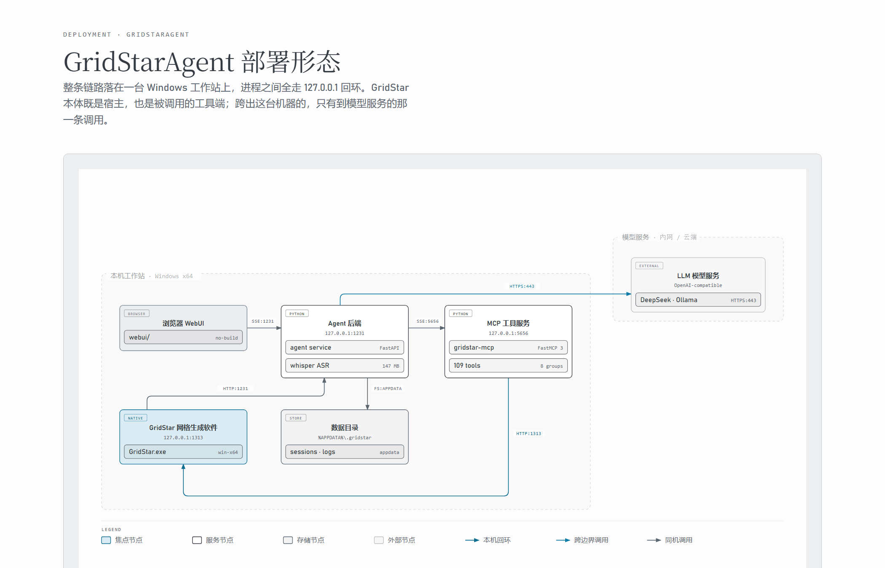

# GridStarAgent

GridStar 网格生成软件的 AI 智能助手：把「CAD 导入 → 水密处理 → 部件分割 → 表面网格 → 各向异性 → 后缘面处理 → 体网格 → 边界条件 → 质量检查 → 导出」的 CFD 非结构网格工作流，交给大模型驱动的 Agent 自动规划并逐步执行。

项目由四部分组成：**MCP 工具服务**（把 GridStar 的 HTTP 接口包装成标准 MCP 工具）、**Python Agent 后端**（LLM 对话循环 + 会话 + 技能 + 工具审批）、**Web 前端**（浏览器聊天界面）与 **Qt 桌面客户端**（同样界面的 C++ 原生实现，供 GridStar 宿主内嵌）。

---

## 功能特性

- **多 Provider 模型接入**：OpenAI Chat Completions / OpenAI Responses / Anthropic Messages，以及 DeepSeek、Ollama、OpenRouter 等任意 OpenAI 兼容服务；模型以 `provider/model` 标识，独立配置上下文窗口、输出上限与能力（工具、并行工具、推理、视觉、流式用量）。
- **125 个 GridStar 工具，按业务域分组**：默认只暴露只读查询与工程文件管理，其余分组由模型按当前阶段调用 `enable_tool_group` 按需启用，避免每轮携带全量 Schema。其中 `screen` 分组提供桌面窗口截图与坐标操作，只在桌面依赖可用时才注册。
- **技能（Skill）系统**：`res/skills/` 下的 12 个 Markdown 技能包按需加载，例如 `cfd-meshing-workflow` 提供完整网格流程路由表，`wing-anisotropy-processing`、`missile-trailing-edge-processing` 提供专项处理步骤；支持 `read_skill` / `read_skill_resource` / `create_skill`。
- **阶段台账与自动模式**：多阶段任务通过内置 `update_plan` 维护全量阶段计划，未创建计划就调用外部工具会被硬拦截；auto 模式下按计划自动推进，manual 模式下每步等待确认。
- **工具审批与人机确认**：有副作用的工具调用可挂起等待用户确认（`/sessions/{id}/tool-approvals/{call_id}`），需要拍板时模型调用 `ask_user_question` 弹出选择卡片。
- **后台任务与断线重连**：Agent 循环运行在独立后台 Task 中，切换会话或刷新页面不中断回复；SSE 断连后按事件序号整体回放，不丢不重；「停止」会真正取消后台任务并补齐被中断的 tool_calls。
- **完整轨迹与会话导出**：每轮请求的系统提示、上下文、请求/响应、工具调用与结果落盘 `trajectory.jsonl`，前端可查看轨迹面板；会话可导出为 Markdown。
- **本地知识库（不依赖嵌入模型，支持多库与归档）**：把用户手册、快速入门、规范与参数说明收进本地索引，模型先检索再作答。切块走文档自带骨架（PDF 书签 → 编号标题 → 段落窗口），中文检索用 2/3-gram 冗余列 + FTS5 bm25 + 标题命中与精确短语重排，不需要任何向量模型，索引可离线重建、结果可审计。可以建多个知识库（如「GridStar 手册」「导弹网格规范」），文件分库导入、索引按库隔离；输入框下方可以选本轮用哪个库、跨库检索或干脆不用。库里的资料还能放进任意层级的文件夹归档，左侧折叠树右侧列表，导入目录时按原目录结构自动建夹。检索入口是三个内置工具：`kb_catalog`（看收录范围）、`kb_search`（定位到页）、`kb_read`（取原文）；正文里夹着 `参数名：说明` 的句子会被额外抽进参数表，回答“默认多少、范围多大”时走精确查表而不是猜。索引落在 `GridstarAgent.data/kb/kb.db`，设置中心「知识库」页签负责建库、归档、导入、看状态与检索试跑。
- **对话界面**：一轮一张卡片（用户 / 助手 / 工具），思考过程与工具调用就地折叠，卡片底部可查看本轮用量与用时明细；对话区最左边缘的**轮次导航轨**按轮次排点，悬浮显示该轮提问、点击直接定位、当前所在轮次高亮；轨迹视图支持按时长 / 轮次 / 调用分组并用时间轴选区过滤；设置中心分「模型 / 技能 / MCP 工具 / 记忆 / 知识库 / 用量」六页签；深色 / 银白 / 蔚蓝三套皮肤。
- **附件与多模态**：拖拽上传文本/代码/PDF/Word/Excel/图片（单文件 10 MB，单次最多 6 个附件 / 4 张图片，文本合计上限 12 万字符）。图片按模型视觉能力送入模型，发送前压到长边 1568、短边 768 以内并转 JPEG（质量 85），整请求的图片编码字节共享 24 MB 预算、图越多每张分到的越少；**图片只活一轮**，只在到达它的那一轮真正发给模型，之后退化成占位文本，避免同一批图随历史反复重传。视觉 token 计入上下文预算，带图会话不会静默顶出窗口。
- **长期记忆（可在设置里关掉）**：把已验证的策略与工程事实沉淀成跨会话记忆，库落在 `.gridstar/memory/memory.db`。自动提炼只写「候选」，只有人工审核通过的记忆才可能被召回；提炼提示词里只有工具名与参数形状，参数原值一个都不进，落库前再过一道脱敏，命中敏感模式整条丢弃。中文检索走应用层 2/3-gram 索引，FTS5 不可用时退回 LIKE 扫描，记忆链路故障不阻断主任务。
- **语音输入**：基于 whisper.cpp 的本地 WAV 转写（`POST /asr`），不上传云端。
- **内网离线分发**：一条命令生成源码 + 离线 wheel + 一键安装脚本的分发包。

---

## 系统架构

```text
┌────────────────────────────┐        ┌──────────────────────────────┐
│  WebUI (webui/)            │        │  Qt 客户端 (QtChartWidget/)  │
│  浏览器聊天界面 /ui/        │        │  Qt 5.12 原生 DLL + demo     │
└─────────────┬──────────────┘        └──────────────┬───────────────┘
              │  HTTP / SSE                          │  推数据 / 收信号
              ▼                                      │
┌─────────────────────────────────────────────────────┴───────────────┐
│  Agent 后端 (agent/agent/)  FastAPI  127.0.0.1:1231                 │
│  agent_loop · llm_client(多 Provider) · session · skill_runtime      │
│  task_ledger · context · document_loader · tool_memory · memory      │
└───────────────────────────────┬─────────────────────────────────────┘
                                │  MCP over SSE (MCP_SERVER_URL)
                                ▼
┌─────────────────────────────────────────────────────────────────────┐
│  MCP 工具服务 (agent/)  FastMCP  SSE 127.0.0.1:5656                  │
│  registry(工具分组) · tools/{project,query,cad,mesh,generation,      │
│  boundary,quality,advanced,screen} · client(HTTP)                   │
└───────────────────────────────┬─────────────────────────────────────┘
                                │  POST http://127.0.0.1:1313
                                ▼
                     GridStar 网格生成软件（本机运行）
```

上图是组件之间的调用关系，下面这张是它们的实际落点。



---

## 目录结构

```text
GridStarAgent/
├── agent/
│   ├── server.py              MCP 服务入口（FastMCP，SSE 5656）
│   ├── registry.py            工具分组注册表（各分组默认是否启用）
│   ├── client.py              GridStar HTTP 客户端（127.0.0.1:1313）
│   ├── tools/                 工具实现：project / query / cad / mesh /
│   │                          generation / boundary / quality / advanced / screen
│   ├── prompt/                内置提示词（CFD 工作流路由表）
│   └── agent/                 Agent 后端
│       ├── app.py             FastAPI 入口（默认端口 1231）
│       ├── agent_loop.py      对话循环：流式、工具执行、审批、计划拦截
│       ├── llm_client/        多 Provider / 多协议 LLM 运行时
│       ├── config.py          模型与 Provider 配置校验、脱敏、落盘
│       ├── paths.py           数据目录（配置 / 会话 / 上传 / 日志 / 导出）解析
│       ├── logging_setup.py   运行日志初始化
│       ├── session.py         会话持久化（messages.jsonl / trajectory.jsonl）
│       ├── skill_runtime.py   技能发现、加载与工具白名单
│       ├── task_ledger.py     阶段计划台账
│       ├── context.py         上下文压缩与大结果外置
│       ├── document_loader.py 附件解析（文本 / PDF / Excel / 图片）
│       ├── kb_index.py        本地知识库：切块、FTS5 索引、词法检索、参数抽取
│       ├── kb_tools.py        知识库工具：kb_catalog / kb_search / kb_read
│       ├── tool_memory.py     工具参数默认值的用户确认记忆
│       ├── memory_store.py    记忆子系统门面（经验库 / 参数记忆统一入口）
│       ├── experience_*.py    长期记忆：异步提炼（extractor）与库存储（memory）
│       ├── memory_sanitize.py 记忆脱敏防线（参数原值不进提示词）
│       ├── data_dir_guard.py  数据目录可写性探测与就地权限修复
│       ├── check_data_dir.py  数据目录自检 CLI（--repair）
│       ├── usage_stats.py     Token 用量聚合（扫描会话落盘记录）
│       ├── mcp_bridge.py      MCP 客户端桥接与工具分组管理
│       ├── workflow_runner.py 预定义步骤工作流执行器
│       └── tests/             pytest 套件（含 fixtures 事件序列）
├── webui/                     浏览器端聊天界面（原生 JS，无构建步骤）
├── QtChartWidget/             Qt 5.12 原生 UI 库 + demo + 接线示例
├── res/skills/                Skill 包（CFD 流程与导弹专用路由、后缘面、各向异性、导弹方向与根部、技能创建）
├── voice_asr/                 语音转写模块（whisper.cpp）
├── docs/                      设计文档
├── package_intranet.py        内网离线分发包打包脚本
├── 一键部署.bat / 一键启动.bat / 一键停止.bat   Windows 一键部署与启停
└── LICENSE
```

---

## 环境要求

| 组件 | 要求 |
| --- | --- |
| Python | **内网离线包按 3.12 打包**（`wheels/` 为 `cp312-win_amd64`）；开发机源码运行 3.10+ 即可。原因见 [内网离线分发](#内网离线分发) |
| 依赖 | 见 [agent/agent/requirements.txt](file:///d:/TRAE_project/GridStarAgent/agent/agent/requirements.txt)：fastapi、uvicorn[standard]、fastmcp 3.x、openai、httpx、pypdf、openpyxl、requests、pywin32 与 pip-system-certs(Windows)；桌面 `screen` 分组另需 mss、uiautomation、Pillow(Windows) |
| GridStar 软件 | 本机运行，HTTP 接口监听 `127.0.0.1:1313`（否则工具调用返回连接失败） |
| Qt 客户端（可选） | Qt 5.12.2 msvc2017_64 + MSVC x64（qmake / nmake） |
| 语音输入（可选） | Windows x64。运行时依赖随包分发（`voice_asr/runtime/`），无需目标机另装 whisper 或 VC++ 运行时 |

---

## 一键部署（Windows）

仓库根目录下三个脚本，双击即可，顺序为 **部署 → 启动 →（用完）停止**。

| 脚本 | 作用 |
| --- | --- |
| `一键部署.bat` | 用 Python 3.12 在仓库根建 `.venv`，安装 `agent/agent/requirements.txt`，随后自检核心模块导入、数据目录可写性、语音模型与部件分割包。可重复执行；`一键部署.bat --reinstall` 会删掉 `.venv` 重建 |
| `一键启动.bat` | 按 9008（部件分割模型服务）→ 5656（MCP）→ 1231（Agent + WebUI）的顺序拉起，每个服务各占一个控制台窗口，逐个探测端口就绪后打开 `http://127.0.0.1:1231/ui/`。已在监听的端口直接复用，不会重复拉起 |
| `一键停止.bat` | 列出 1231 / 5656 / 9008 的监听进程，确认后结束 |

前置条件：Windows x64 + Python 3.12（`py -3.12` 可用）；用自动部件分割时，本机需已启动 GridStar 软件（`127.0.0.1:1313`）。

可选环境变量（在 `cmd` 里 `set` 后运行脚本）：

| 变量 | 默认 | 说明 |
| --- | --- | --- |
| `PYTHON` | 自动探测 | 部署时用于创建 `.venv` 的解释器完整路径 |
| `GRIDSTAR_SEG_HOME` | 自动发现同级 `GridStar_*` 目录 | 部件分割部署包目录（含 `start_server.bat` 的那一层） |
| `SKIP_SEG` | `0` | 置 `1` 则跳过 9008 模型服务 |
| `OUT_DIR` | `D:\A_GridStarCode\output` | `ProcessWithServer` 的 `outputDir`，启动时自动创建（工具要求该目录已存在） |
| `PIP_INDEX_URL` | 官方源 | 内网/镜像源地址，如 `https://pypi.tuna.tsinghua.edu.cn/simple` |

仓库根目录下若存在 `wheels\`，`一键部署.bat` 会自动改用 `pip install --no-index --find-links wheels`，全程不联网——内网离线包就是按这个约定组织的，解压后直接双击 `一键部署.bat` 即可。

### 自动部件分割

`一键启动.bat` 会用部件分割部署包自带的解释器（默认 `D:\Envs\gridstar_ptv3\Scripts\python.exe`，与 `启动服务_本机.bat` 一致）预设 `PYTHON` 后调用同目录的 `start_server.bat`，效果等同双击 `启动服务_本机.bat`：模型加载约 15 秒，日志出现 `listening on 0.0.0.0:9008` 即就绪。

技能里的默认参数是远程服务器 `7.31.130.92:9008`；要用本机模型服务，在对话中显式给出：

```text
ProcessWithServer serverHost=127.0.0.1 serverPort=9008 outputDir=D:/A_GridStarCode/output
```

---

## 快速开始

### 1. 安装依赖

```bash
python -m venv .venv
.venv\Scripts\activate
pip install -r agent/agent/requirements.txt
```

### 2. 启动 MCP 工具服务

需要 GridStar 软件已在本机运行。

```bash
cd agent
python server.py
```

默认以 SSE 方式监听 `127.0.0.1:5656`；后端可用环境变量 `MCP_SERVER_URL` 指向其他地址，如 `http://127.0.0.1:5656/sse`。

### 3. 启动 Agent 后端

```bash
cd agent/agent
python app.py --host 127.0.0.1 --port 1231
```

打开 <http://127.0.0.1:1231/> 即进入聊天界面（自动跳转到 `/ui/`）。

### 4. 配置模型

首次启动没有可用模型，在界面「设置」中：

1. 新增供应商：填写名称、API 地址（如 `https://api.deepseek.com/v1`）、API Key（也可只填「API Key 环境变量」走环境变量，避免密钥落盘），并选供应商类型：`OpenAI / Compatible / Ollama`、`Anthropic` 或「不支持模型发现」。
2. 「测试连接」→「读取模型」拉取候选列表，勾选需要启用的模型；默认 API 协议按供应商类型预填（`openai-chat` / `openai-responses` / `anthropic-messages`），未显式填写上下文窗口时会按内置元数据自动补齐。
3. 设为默认模型并保存。

配置写入数据目录下的 `config.json`，接口返回与日志中的 API Key 一律脱敏。

### 5. 开始使用

新建会话 → 选择模型与（可选）Skill → 描述目标，例如「导入 D 盘的这个 step 文件，生成一套完整的机翼网格」，Agent 会按流程规划阶段、按需启用工具分组并逐步执行；有副作用的操作会弹出审批卡片，需要决策时会给出选择卡片。

---

## 数据目录

会话、配置、日志、上传文件与知识库索引统一放在当前用户数据目录下的 `GridstarAgent.data`，位置固定，不提供自定义开关：

| 平台 | 位置 |
| --- | --- |
| Windows | `%USERPROFILE%\AppData\Roaming\GridstarAgent.data`（即 `%APPDATA%\GridstarAgent.data`） |
| Linux / macOS | `~/.local/share/GridstarAgent.data` |

```text
GridstarAgent.data/
├── config.json               模型与 Provider 配置
├── tool_parameter_memory.json 工具参数默认值的确认记忆
├── memory/memory.db          长期记忆库（策略经验 + 工程事实）
├── kb/kb.db                 知识库索引（FTS5 + 参数表）
├── kb/sources/               知识库原始文件副本（回源核对用）
├── sessions/<uuid>/          messages.jsonl、trajectory.jsonl、meta
├── skills/                   运行期可写技能目录
├── uploads/                  附件原文件
└── logs/                     运行日志
```

旧版本使用 `ClineLikeChat`、`.gridstar` 目录名，首次启动时若新目录不存在会自动搬迁过来，已有配置与会话随之保留；两边同时存在时只用新目录并记一条警告，不做合并。

### 目录写不进去时

以另一个账号运行过、或目录属主是别的账号（SYSTEM、早先的服务账号）时，当前账号可能没有写权限。启动流程按顺序处理，不换目录写：

1. 当场实测可写性（建一个临时文件再删掉，不看 ACL 猜）；
2. 不可写就在当前进程内修：必要时启用 `SeTakeOwnership`/`SeRestore` 令牌特权，先 `icacls` 授权给当前账号，不行再 `takeown` 接管属主后重试。目录属主通常就是当前账号，这一步多半直接成功，不重启进程、不弹 UAC；
3. 当场修不动且当前进程未提权，用 UAC 提权重启一次，并把数据目录钉给新进程。**提权后 `%APPDATA%` 会指向提权账号的用户目录，钉住目标目录才能让数据仍然落在这个位置**；
4. 修不动又无法提权时明确失败并打印人工命令，不会静默换目录。

`GET /health` 返回 `data_dir` / `data_dir_writable` / `data_dir_repair_attempted` / `data_dir_error`，可直接判断权限状态。

内网机器上先跑自检：

```cmd
python check_data_dir.py            :: 只看状态
python check_data_dir.py --repair   :: 顺手执行一次修权限
```

---

## 工具分组

MCP 服务共注册 125 个业务工具 + `GetToolGroups` 发现入口，按域分组：

| 分组 | 默认启用 | 说明 |
| --- | :---: | --- |
| `project` | ✅ | 工程文件：打开/保存/另存 SPD、导入导出 CAD 与网格、清空数据、撤销重做、导出求解器格式 |
| `query` | ✅ | 只读查询：对象 ID、网格线起终点与点数、选中对象、屏幕法向、几何参数(MAC)、默认参数、分部件分组属性 |
| `cad` | | CAD 几何：曲面平移/旋转/缩放/镜像、曲面加工与损伤修复、水密处理、求交、手动/自动提线、Coons 曲面、分部件分组增删改 |
| `mesh` | | 网格拓扑编辑：网格线/面/块删除、平移旋转镜像、拼接装配分裂、端点移动、点数与间距分布 |
| `generation` | | 网格生成：表面网格、体网格/块创建、长窄面网格、机翼各向异性处理 |
| `boundary` | | 边界条件：分组增删、属性配置、保存到计算域 |
| `quality` | | 质量检查：网格线 / 网格面 / 网格块质量评估 |
| `advanced` | | 高级批处理：服务端组合流程、后缘面分类与类型一/类型二批量处理、前缘识别 |
| `screen` | | 桌面自动化：定位 GridStar 窗口、窗口截图、读取 UI 控件、按画面坐标点击/拖动/滚轮、模拟控件点击与键盘输入。GridStar 不暴露 UI 自动化控件（控件树为空），实际可用的是「截图 → 看图 → 坐标操作」这条路线 |

技能可通过 frontmatter 中的 `allowed-tools` 进一步收窄当前会话允许调用的工具范围。

`screen` 分组的依赖（pywin32 / mss / uiautomation）只在带桌面的 Windows 上成立，导入失败时只丢这一个分组，不会连带其余工具与 MCP 服务一起下线。

除业务工具外，后端还内置了一批不占 GridStar 工具额度的工具：阶段台账 `update_plan`、分组开关 `enable_tool_group`、选择卡片 `ask_user_question`、只读目录列举 `ListDirectoryFiles`（支持通配符过滤与递归，最多返回 200 条），以及技能读写 `read_skill` / `read_skill_resource` / `create_skill`。

---

## Qt 桌面客户端

[QtChartWidget](file:///d:/TRAE_project/GridStarAgent/QtChartWidget/README.md) 是 `webui/` 的 Qt 5.12 原生复刻，编译为 `QtChartWidget.dll` + 可交互示例 `demo.exe`。库本身**不发任何网络请求**：宿主通过 setter 推数据、通过信号收交互，便于直接嵌入 GridStar 主程序。

```bat
cd QtChartWidget
build.bat          rem 构建 DLL、demo 与接线示例
build.bat shot     rem 构建后离屏截图到 QtChartWidget\shot.png
```

若本机 Qt / VS 路径不同，修改 `build.bat` 顶部的 `QTDIR`、`VCVARS` 即可（该脚本须保持纯 ASCII）。

---

## 语音输入（可选）

`voice_asr` 通过本地 whisper.cpp 把录音 WAV 转成文字，由后端 `include_router` 同源挂载：

- `GET /asr/health`：报告 shim / 模型是否就绪（**不会触发加载 147MB 模型**），未就绪时前端自动禁用语音按钮。
- `POST /asr`：multipart 上传 `audio`（16kHz / 16bit / 单声道 WAV），返回转写文本。

实现是进程内调用 `asr_shim.dll`，不再依赖外部 `whisper-cli.exe`：模型常驻内存，冷启动加载约 0.24s，5 秒中文音频转写约 1.3–1.6s（RTF ≈ 0.3）。

运行时资产（都被 `.gitignore` 排除，需单独同步）：

| 路径 | 内容 | 大小 |
| --- | --- | --- |
| `voice_asr/runtime/` | whisper.dll、ggml*.dll、VC 运行时 4 件 | 2.6 MB |
| `voice_asr/runtime/models/` | `ggml-base.bin` | 147 MB |
| `voice_asr/native/bin/` | `asr_shim.dll`（`native/build_shim.bat` 构建） | 0.16 MB |

补齐办法：`python voice_asr/native/sync_runtime.py`（从 GS 安装包同步 DLL 与模型）。

配置项均可用环境变量覆盖：`WHISPER_MODEL`、`WHISPER_DLL`、`WHISPER_RUNTIME`、`WHISPER_LANG`（默认 `zh`）、`WHISPER_THREADS`、`WHISPER_TIMEOUT`、`ASR_MAX_BYTES`。

---

## 知识库

把手册与规范收进本地索引，模型先查后答，并在回答里给出章节与页码。整条链路不依赖嵌入模型：中文切 2/3-gram 写进冗余列，用 SQLite FTS5 的 bm25 粗排，再用标题命中与精确短语重排。

**导入**：设置中心「知识库」页签 → 添加文件（PDF / Word / Excel / Markdown / 纯文本，单文件上限 64 MB）或直接填一个本机目录批量导入。导入即建索引，不用重启；同一份文件重导会覆盖旧索引。原始文件会存一份到 `GridstarAgent.data/kb/sources/`，将来要核对原文不依赖你本地目录还在原位。

**三个工具**：

| 工具 | 作用 | 什么时候用 |
| --- | --- | --- |
| `kb_catalog` | 列出文档与章节标题树（不含正文） | 不知道资料里有没有相关内容 |
| `kb_search` | 检索并返回定位（文档 / 章节 / 页码）+ 摘录，附带参数卡片 | 主路径 |
| `kb_read` | 按 chunk_id 取原文（可带前后块） | 回答参数值、步骤、注意事项之前必须调 |

**多知识库**：资料可以分库放。设置中心「知识库」页签里能新建、改名、删库，每个库只显示自己的文件；上传与导入目录都进当前选中的库。同一份文件可以同时存在于两个库（`kb_doc` 主键带库归属，两份独立索引）。

输入框下方的「知识库」选择器决定本轮的范围，三态：

| 选项 | 含义 |
| --- | --- |
| 某个库 | 只检索这个库 |
| 全部知识库 | 跳库检索，结果里标出库名 |
| 不使用知识库 | 三个工具都返回「本轮未启用」，模型不得改用自身知识凑答案 |

选择存在会话 meta 里，刷新或切回会话会自动恢复；库被删时后端会退回「全部」，不会静默变成空结果。

**归档（文件夹）**：库里的资料可以放进任意层级的文件夹。设置页左侧是可折叠的归档树，右侧是当前文件夹的文档列表。文件夹**只负责摆放，不参与检索范围**：在哪个文件夹里搜，结果都是整个库。多一层作用域就多一次“我该在哪儿找”的犹豫，而折叠本身已经把“列表太长”解决了。

- 导入目录时按原目录层级自动建文件夹（请求里的 `mirror_tree`），几千份资料不用一份份拖。
- 删除文件夹不删资料：里面的文档与子文件夹全部上移到上一层。
- 每行文档右侧有个归档下拉框，可以单独挪进别的文件夹。
- 同一层不许重名（不同层可以）；文件夹不跨库复用。

**切块**：走文档自己的骨架。PDF 有书签就按书签切（并标出章节路径与页码区间），没有书签退回编号标题正则，再退回段落窗口；超长节按段落切成约 600 字并带重叠。

**参数表**：正文里 `参数名：说明` 形式的句子会被抽进 `kb_param`（名称、模块、默认值、取值范围、单位、原文出处），数值范围允许从同段的下一句补。问答“增长率能设多少”时走精确查表，不用模型自己从散文里推。

**边界**：没有向量召回，所以换个说法问同一个概念可能召回不到（比如问“网格太丑”而文档里写“质量优化”）。先用手册里的说法检索；真需要语义这一路时，应补的是一个 CPU 能跑的 reranker，而不是整套向量库。

冒烟验证（导目录 + 跑一组提问，看命中章节对不对）：

```bash
python verify/kb_smoke.py "D:\资料\GridStar手册"
python verify/kb_smoke.py          # 不传路径就直接问现有索引
```

---

## 测试

```bash
cd agent/agent
python -m pytest tests -q
```

```bash
# 语音模块（在仓库根目录执行）
python -m pytest voice_asr/tests -q
```

`agent/agent/tests/` 以 mock 的 `ModelRuntime.stream` 与 MCP 调用为基准，用 fixtures 里的预设事件序列校验 Agent 循环的事件流（工具调用、结构化续写、格式重试、auto 模式计划拦截等）。`test_kb_index.py` 用临时库验证切块、检索、参数抽取与读回，不依赖真实手册。

---

## 内网离线分发

```bash
python package_intranet.py                          # 源码 + 当前平台离线依赖（默认 3.12）
python package_intranet.py --no-wheels               # 只打包源码
python package_intranet.py --python-version 313 --platform win_amd64
```

产物为 `dist/GridStarAgent_intranet_<日期>.zip`，内含源码（含 `一键部署.bat` / `一键启动.bat` / `一键停止.bat`）、`wheels/`、`requirements.txt`、`voice_asr` 运行时资产与 `install_offline.bat`。

### 内网机器上的操作顺序

1. 把 zip 拷进去，解压到本地目录（不要直接在压缩包里双击运行，UNC 路径下 `venv` 会跑不起来）。
2. 确认目标机已装 **Python 3.12 64 位**（`py -3.12 -V` 能打印版本即可）。
3. 双击 `一键部署.bat`。检测到同级的 `wheels\` 时自动切离线模式（`--no-index --find-links wheels`），不访问任何外网源；建好 `.venv` 后跑导入、数据目录、语音模型、部件分割包自检。
4. 双击 `一键启动.bat`，按 9008 → 5656 → 1231 依次拉起并打开界面。
5. 首次使用在「设置」里配模型供应商。若模型服务也在内网，API 地址填内网地址即可。

也可以继续用手写的 `install_offline.bat`：它建的是 `venv\`，`一键启动.bat` 会自动在 `.venv\` 与 `venv\` 之间择一，两者都可用。

内网机器上拿不到 `pip` 源时不要跑 `一键部署.bat --reinstall`（重建后仍需装依赖，此时若没有 `wheels\` 会失败）。

### 需要单独确认的三件事

- **模型服务可达**：Agent 只访问你配置的 LLM API。纯内网请填内网部署的 OpenAI 兼容服务（Ollama / vLLM 等）。
- **GridStar 软件**：本机 `127.0.0.1:1313` 必须监听，否则所有工具调用返回连接失败。
- **部件分割包**：不是本仓库内容，需单独拷入，且目标机要有 `D:\Envs\gridstar_ptv3` 这个解释器环境（或 `set GRIDSTAR_SEG_HOME=` 指向包目录、`set PYTHON=` 指向实际解释器）。

### 目标机前置条件

打包脚本把语音运行时（含 VC++ 运行时 4 个 DLL）都放进了包，但有两件事它替不了：

1. **Python 3.12 64 位**。`install_offline.bat` / `一键部署.bat` 都不捆绑 Python，前者用 PATH 上的 `python`（可用 `set PYTHON=<绝对路径>` 指定），后者优先 `py -3.12`。而 `wheels/` 里带 ABI 标签的 wheel 是 `cp312-win_amd64`，所以目标机必须是 3.12；版本不一致会在 `pip install` 阶段直接失败。打别的版本：`python package_intranet.py --python-version 313`。
2. **Windows 10/11 x64**。`voice_asr` 的 4 个 DLL 与 shim 都是 x64 PE，32 位 Python 加载会失败。

其余都不需要：不必装 Visual Studio，不必装 VC++ 可再发行组件包，不必装 whisper.cpp 或任何 exe。

### 装完先跑这两个检查

```bash
:: 在解压出来的包目录里（用 一键部署.bat 建的是 .venv，用 install_offline.bat 建的是 venv）
.venv\Scripts\python -c "from voice_asr.config import settings; print(settings.is_ready(), settings.model)"
.venv\Scripts\python voice_asr\smoke_test.py --backend-only
```

第一条只查三个路径是否就位（快）；第二条加载真模型跑一段真音频，是「语音到底能不能用」的判据，退出码 0 即通过。

服务起来后还有一次 HTTP 级确认，`ready` 必须是 `true`：

```bash
venv\Scripts\python -c "import json,urllib.request; print(json.load(urllib.request.urlopen('http://127.0.0.1:1231/asr/health')))"
```

为 `false` 时看同一响应里的 `shim` / `model` 两个路径，缺哪个补哪个。界面在 `http://<主机>:1231/ui/`（`/` 会 307 跳过去）。

---

## 许可证

[MIT](file:///d:/TRAE_project/GridStarAgent/LICENSE) © 2026 Tsolodancer